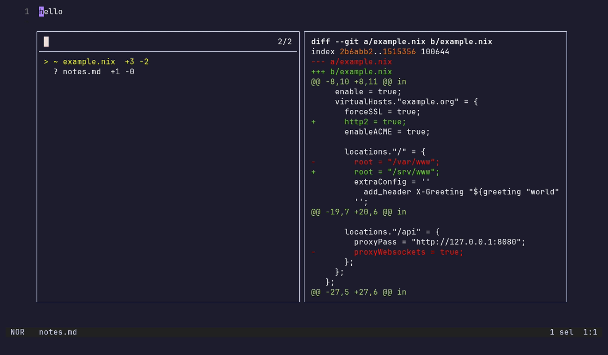
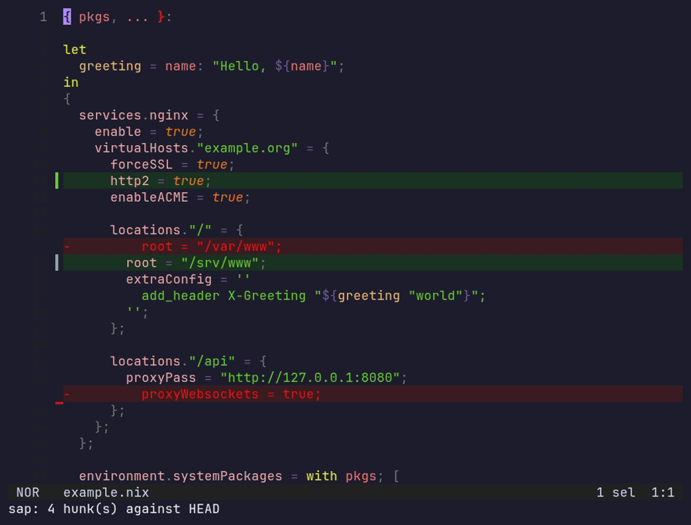
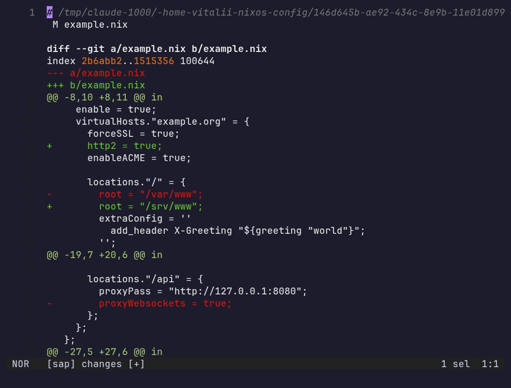

# sap.hx

See what changed, in [Helix](https://helix-editor.com): your git changes
expanded right in the buffer, every change in the repository in one place,
and hunk staging, as a [Steel](https://github.com/mattwparas/steel) plugin.
Named for sapwood, the young, live layer of a trunk.

The model is [gitsigns.nvim](https://github.com/lewis6991/gitsigns.nvim) in
the buffer and [diffview.nvim](https://github.com/sindrets/diffview.nvim)'s
file panel, kept small.



`space g` is Helix's own picker with your changed files, each previewed as
its diff against `HEAD`. Enter opens the file at its first change with the
changes expanded:



Helix's gutter shows *where* lines changed. sap shows *what*: removed lines
come back as red rows where they were, added and changed lines are
highlighted. It diffs the buffer, unsaved edits included, against `HEAD`, the
same base as the gutter, and redraws when you save.



`:sap-changes` puts `git status` and the whole diff against `HEAD` in one
buffer with diff highlighting. Search it, scroll it, and press enter on any
line to open that file at that line with its changes expanded.

## Commands

| Command | What it does |
| --- | --- |
| `:sap-picker` | Changed files in Helix's picker (`~ path  +3 -1`), each previewed as its diff against `HEAD`; enter opens the file at its first change, expanded. Falls back to `:sap-changes` without dna.hx's picker patch |
| `:sap-changes` | Every change in the repository against `HEAD`, in one buffer; enter opens the file at that line |
| `:sap-toggle` | Expand the focused file's changes in place, or hide them |
| `:sap-preview` | Expand only the hunk under the cursor (toggle) |
| `:sap-stage-hunk` | Stage the hunk under the cursor |
| `:sap-unstage-hunk` | Unstage it |
| `:sap-reset-hunk` | Throw away the unstaged hunk under the cursor |

Hunk actions need the file saved. Helix's own `]g` / `[g` move between
hunks.

## Requirements

- Helix built from the Steel branch (`mattwparas/helix`,
  `steel-event-system`), see its
  [STEEL.md](https://github.com/mattwparas/helix/blob/steel-event-system/STEEL.md).
- The virtual-text and picker APIs from
  [dna.hx](https://github.com/vitaliikindrat/dna.hx)
  (`helix-virtual-text.patch`, `helix-picker.patch`) applied to that build.
  The theme patch (`helix-theme.patch`) is optional, for colours inherited
  from any theme. Without the others sap loads, `:sap-changes` and the hunk actions work, the
  picker falls back to the changes buffer, and the in-place views say what
  is missing.
- `git` on `PATH`.

## Install

With forge:

```sh
forge pkg install --git https://github.com/vitaliikindrat/sap.hx.git
```

With Nix, the flake exposes `packages.<system>.sap` (with
`passthru.cogName = "sap"` for
[helix-plugins-nix](https://github.com/maxschipper/helix-plugins-nix)); take
the patch from dna.hx.

Then in `~/.config/helix/init.scm`:

```scheme
(require "sap/sap.scm")

(require (only-in "helix/keymaps.scm" keymap))
(keymap (global)
        (normal (space (g ":sap-picker")
                       (v (c ":sap-changes")
                          (d ":sap-toggle")
                          (p ":sap-preview")
                          (s ":sap-stage-hunk")
                          (u ":sap-unstage-hunk")
                          (r ":sap-reset-hunk")))))
```

## Theme

| Scope | Used for |
| --- | --- |
| `ui.virtual.diff.minus` | background of removed rows (text uses `diff.minus`) |
| `ui.virtual.diff.plus` | background of added and changed lines |

No theme has these, so with dna.hx's theme patch sap inherits them: a fifth
of the theme's `diff.minus` / `diff.plus` (the gutter's colours) over its
background, worked out again whenever the theme changes. A theme that sets
them keeps its own:

```toml
"ui.virtual.diff.minus" = { bg = "#3b1d22" }
"ui.virtual.diff.plus" = { bg = "#1b3324" }
```

## Development

```sh
steel tests/util-test.scm   # the diff parsing, hunk lookup and patch building
nix flake check             # the same, in Nix
```

Running git follows [hardhus/helix-git](https://github.com/hardhus/helix-git)'s
approach.

## License

MIT.
